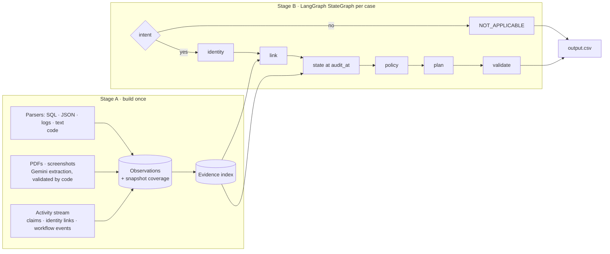

# Ghost Data Audit Agent

**HackerRank Orchestrate (October 2026) — Ghost Data Still Exists** · **Rank: 150** (provisional)

My solution to the [Ghost Data Still Exists](https://www.hackerrank.com/contests/hackerrank-orchestrate-october26/challenges/ghost-data-still-exists)
challenge in the HackerRank Orchestrate October 2026 contest.

## The problem

Start with [`problem_statement.md`](problem_statement.md). In short: a fictional shop's deletion workflow reports
**"Complete"**, yet the customer's data survives in replicas, logs, support attachments, exports, search indexes,
analytics and backups, and sync or restore jobs can bring deleted data back. For each of 518 deletion requests,
the agent must decide whether the person really asked for deletion, find every remaining copy of their data at the
case's `audit_at` time, and output `COMPLETE`, `INCOMPLETE` or `NOT_APPLICABLE` with an ordered plan of findings,
remediation and verification steps (`case_id,deletion_status,steps_json`).

## The solution

An evidence-driven agent that decides, for every deletion request, whether a person's data is really gone. It
reads the deletion request, works out who the person is (including old emails and their hashes), reconstructs
the state of every record at `audit_at` from SQL snapshots, JSON exports, logs, PDFs and screenshots, applies
`deletion_rules.csv`, and writes an ordered plan of findings, remediation and verification steps.

**Design principle: the model describes, code decides.** Gemini is used only where language or vision is
needed (request intent, PDFs and screenshots). Every decision that affects the answer is deterministic Python,
so results are reproducible, explainable and cheap.

## Results

| | Public samples (32) | Custom cases (4) |
|---|---|---|
| Status accuracy | **100%** | 100% |
| Step precision / recall / F1 | 94.3% / 93.8% / **94.0%** | 100% |
| Exact ordered sequence | 62.5% | 100% |
| Citation accuracy (found steps citing the exact evidence) | **100%** (181/181) | 100% |

Full run: 518 valid rows, 0 contract violations, byte-identical when re-run offline from the cache.
Model usage for the full run: 38 Gemini answers, 88,367 tokens (≈171 per request), ≈$0.21 at list prices,
$0 on the free tier. Details: [`code/evaluation/evaluation_report.md`](code/evaluation/evaluation_report.md),
[`code/evaluation/usage_report.md`](code/evaluation/usage_report.md).

## Architecture



- **Stage A** parses all 94 evidence files once into one common `Observation` record (time, system, resource,
  category, exists / exposed / active, identifiers) and complete-snapshot `Coverage` records.
- **Stage B** runs one LangGraph per request (`graph.batch` in parallel) after three global pre-passes: intent of
  every distinct text, identity resolution, and linking (each resource assigned to exactly one case).
- Full design: [`code/docs/ARCHITECTURE.md`](code/docs/ARCHITECTURE.md). Requirements:
  [`code/docs/PRD.md`](code/docs/PRD.md). Every design decision with alternatives:
  [`code/docs/DECISIONS.md`](code/docs/DECISIONS.md).

### Key rules (all derived from the data, none hardcoded)

- **Identity:** request email matched case-insensitively against current and historical emails; the full change
  chain is walked; `sha256(lowercase(email))` of every email is matched against hash-keyed records.
- **Point in time:** a fact counts if it was true at `audit_at`; it can be **cited** only if its file was captured
  by `audit_at`. Reported statuses and activity results are claims, never proof.
- **Ghosts:** a record still present in any replica of a snapshot is present. A complete snapshot that omits a
  record proves it absent; empty snapshots prove nothing; errors and timeouts never mean absent.
- **Linking:** exact strong identifiers only (decoys like `name.jr@` exist; names never link alone). Records with no
  identifiers left are linked through the deletion workflow's own events around `reported_at`, assigned globally.
- **Policy & ordering:** `deletion_rules.csv` per category (delete / redact / anonymize / retain / tombstone);
  restorable backups → block restore; active flows → disable first. Steps sorted by phase, the spec's operation
  order, `system_id`, `resource_id`.
- **Safety:** evidence text is treated as data (prompt-injection resistant); a unit test fails if any case or
  evidence id appears in the code.

## Quick start

No API key needed: every Gemini answer the run uses is cached in `code/.cache/`, so the full pipeline runs
offline and reproduces `output.csv` byte for byte.

```bash
git clone <this-repo-url>
cd hackerrank-orchestrate-october26
python -m venv .venv
# Windows: .venv\Scripts\activate      macOS / Linux: source .venv/bin/activate
pip install -r code/requirements.txt

python code/main.py run --offline                  # writes output.csv (518 rows)
python code/evaluation/main.py --offline           # scores against the 32 public samples
python -m unittest discover -s code/tests          # 34 unit tests
```

## Setup

Requirements: Python 3.11+ (developed on 3.14, Windows; paths are OS-independent).

```bash
pip install -r code/requirements.txt
```

Optional, only needed to call Gemini live (for example after changing a prompt or adding new evidence).
Copy `.env.example` to `.env` in the repository root and fill it in; `.env` is gitignored.

```bash
GEMINI_API_KEY=your-key
# optional overrides
INTENT_MODEL=gemini-3.5-flash-lite
VISION_MODEL=gemini-3.5-flash
LLM_RPM=4
```

## Run

All commands run from the repository root and read only `dataset/`. If you run from a packaged `code.zip`
instead of this repo, place the challenge's `dataset/` folder next to `code/` (the zip does not include it).

```bash
# Produce output.csv (518 rows) and code/evaluation/usage_report.md
python code/main.py run              # online: calls Gemini for anything not cached
python code/main.py run --offline    # reproducible: cached answers only, never reads .env

# Optional: one JSON trace per case explaining identifiers, links, states and rules
python code/main.py run --offline --trace

# Inspect Stage A only (evidence index summary)
python code/main.py index --offline

# Evaluate on the 32 public samples + 4 custom cases and regenerate the report
python code/evaluation/main.py --offline --write-report

# Unit tests (standard library only)
python -m unittest discover -s code/tests
```

## Project layout

```text
README.md                  this file
problem_statement.md       the challenge specification
output.csv                 final predictions (518 rows)
dataset/                   challenge inputs: requests, identities, audit log, activity, rules, evidence/
.env.example               template for the optional Gemini key
code/
  main.py                  CLI: index | run
  requirements.txt
  docs/                    PRD.md, ARCHITECTURE.md, DECISIONS.md
  audit/                   the agent
    evidence/              records.py, sql.py, json_records.py, logs.py, text.py, documents.py
    llm/gateway.py         Gemini calls: cache, rate limit, retries, daily-quota failover, token meter
    normalize.py  loaders.py  models.py  activity.py  index.py            (Stage A)
    intent.py  identity.py  linking.py  state.py  policy.py  planner.py
    validate.py  graph.py  pipeline.py  output.py  usage_report.py         (Stage B)
  evaluation/              main.py, metrics.py, custom_cases.py, report.py,
                           evaluation_report.md, usage_report.md
  tests/                   test_stage_a.py, test_stage_b.py (34 tests)
  .cache/                  cached Gemini answers (JSON), so runs are reproducible offline
```

Prompts live in source: `code/audit/intent.py` (intent) and `code/audit/evidence/documents.py` (documents).

## Known limitations

- Three expected resources in the public samples appear in no evidence and no activity row; we never guess ids.
- When the deletion workflow processes several cases in one batch, its log orders events by resource id, so a
  few identifier-less records (deleted accounts, anonymized analytics) cannot be told apart between those cases.
- Evaluation numbers come from 32 public samples and 4 custom cases; tuning stopped once the remaining errors
  were impossible or symmetric ties, to avoid overfitting.
