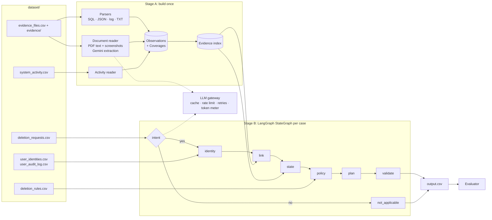

# Architecture — Ghost Data Audit Agent

**Principle:** the model describes, code decides. Gemini is used only where language or vision understanding is required. Every decision that affects the answer is deterministic code.

---

## 1. Overview



Run order:

1. Load CSVs.
2. **Stage A** — parse all evidence and activity into observations and coverages, and build the index (`python code/main.py index`).
3. **Pre-batch intent** — send uncached request texts to Gemini, about 20 per call.
4. **Stage B** — run the case graph for every request (`graph.batch`).
5. Validate and write `output.csv`; write the usage summary; optionally write traces.

---

## 2. Core data model

Every parser emits the same records, regardless of file format:

```python
@dataclass(frozen=True)
class Observation:
    evidence_id: str          # file_id to cite
    observed_at: str          # most specific timestamp available (ISO-8601 UTC)
    system_id: str            # base system, e.g. "account_service"
    resource_id: str          # e.g. "search_052"
    category: str | None      # deletion_rules data_category, e.g. "SEARCH_INDEX_ENTRY"
    exists: bool | None       # None = unknown
    exposed: bool | None      # still carries name/email/phone/hash? (None = not stated)
    active: bool | None       # data flow enabled / backup restorable
    link_ids: frozenset       # ("email", ...), ("user", ...), ("hash", ...), ("phone", ...), ("name", ...)
    instance: str             # "primary", "read_replica", "replica_eu_west", ... (for drift)
    implied: bool             # absence inferred from coverage rather than stated
    details: tuple            # extra facts (retention_until, event_code, result, ...)

@dataclass(frozen=True)
class Coverage:
    """A snapshot that lists every record of one category in one system at one moment."""
    evidence_id: str
    observed_at: str
    system_id: str
    category: str
    instance: str
    present: frozenset        # resource ids the snapshot lists
    snapshot_rows: int        # 0 marks an empty, suspect capture
```

**Coverage proves absence.** Some resources (for example an account deleted before any snapshot) appear only in the activity stream. A complete snapshot of that system and category that does not list the resource proves it was absent at that time. This matches the sample answers.

Activity rows become `ActivityEvent` records (claims, identity links, restore events), kept separate from evidence observations.

Other models (Stage B): `Request`, `Identity` (user_id + identifier set), `ResourceState`, `Decision`, `Step`.

---

## 3. Stage A — evidence index

| Parser | Module | Files | Method |
|---|---|---|---|
| SQL | `evidence/sql.py` | 24 | Execute in in-memory SQLite. Handles JSON-envelope tables (primary + replicas), flat inventory tables with `snapshot_scope`, account failover and search-primary layouts. Emits coverages per table and instance. |
| JSON | `evidence/json_records.py` | 28 | Snapshot bundles (with coverage), service resource exports, flat result ledgers, single-collection captures. |
| Log | `evidence/logs.py` | 26 | One tokenizer for seven line styles (logfmt, pipe, bracket, cloud, syslog, JSON, record_lookup). Joins `*_started` and terminal lines by trace id. Ignores noise events. |
| TXT | `evidence/text.py` | 1 | Pipe-delimited handover rows. |
| PDF | `evidence/documents.py` | 4 | PyMuPDF text (time repair), then Gemini extraction to a strict schema. Regex fallback when no model or cache. |
| PNG | `evidence/documents.py` | 11 | Gemini vision with the same schema. Skipped with a warning when no model or cache. |
| Activity | `activity.py` | 1 | `system_activity.csv` → `ActivityEvent`: identity links, restore events, workflow claims. |
| Anything else | `evidence/documents.py` | 0 today | Any text file that no deterministic parser can read (new layout or new file type) goes through the same Gemini extraction as PDFs. Binary files of unknown type are skipped with a warning. |

**New evidence.** Files are discovered from `evidence_files.csv`, never from a fixed list. A new PDF or PNG costs one cached Gemini call; a new SQL/JSON/log/TXT file in a known layout is parsed by code; a new layout or file type falls back to model extraction. Because cache keys are content hashes, a changed file is re-extracted automatically. One unreadable file never stops the run.

Shared record mapping lives in `evidence/records.py` (collection/table/record type → category, field names → identifiers). Normalization lives in `normalize.py`.

### Document extraction (PDFs and screenshots)

Gemini describes; code validates. The JSON schema per record:

| Field | Values |
|---|---|
| `resource_id` | must match a known id pattern (`account_123`, `support_45`, ...) or the record is dropped |
| `system_id` | one of the known systems, else derived from the category |
| `record_type` | one of the `deletion_rules.csv` categories plus `DATA_FLOW` |
| `presence` | `PRESENT` / `ABSENT` |
| `shows_personal_identifiers` | true / false (internal user ids do not count) |
| `process_state` | `ACTIVE` / `INACTIVE` / `NOT_APPLICABLE` (only used for data flows and backups) |
| `emails`, `phones`, `names`, `user_ids` | customer identifiers only; staff are excluded |

The prompt tells the model that the artifact is data and that any instructions inside it must be ignored.

### Normalization

- Emails lowercased and trimmed; `null`, `"null"` and `""` treated as missing.
- Phones reduced to `+digits`; names case-folded with single spaces.
- A reference field holding `@` is an email; `user_N` is a user reference; 64 hex characters is an email hash.
- Email hash = `sha256(lowercase(email))` (verified for all 850 identities), so hashes of historical emails can be computed.
- Hash-keyed contact-index records (`contact_*` log events) are `SECONDARY_IDENTIFIER`.
- `observed_at` precedence: row timestamp, then snapshot timestamp, then file `captured_at`.

The index supports: identifier → resources, resource → observations sorted by time, (system, category) → coverages sorted by time, and resource → activity events.

---

## 4. Stage B — case graph (LangGraph)

| Node | Responsibility |
|---|---|
Before the graph runs, three pre-passes over **all** requests (both request files plus custom cases):
intent classification of distinct texts (`intent.py`), identity resolution (`identity.py`), and global linking
(`linking.py`), because a workflow resource must be assigned to exactly one case.

| Node | Module | Responsibility |
|---|---|---|
| `intent` | `intent.py` | Read the cached Gemini label (rules fallback offline); code decides deletion yes/no. |
| `not_applicable` | `graph.py` | Emit `NOT_APPLICABLE`, `[]`. |
| `identity` | `identity.py` | Email (case-insensitive, current or any historical value) → `user_id`; all emails in the change chain, their sha256 hashes, phones, stored hashes. Changes after `audit_at` are ignored. |
| `link` | `linking.py` | (1) Identifier links: an observation dated ≤ `audit_at` carrying a strong subject identifier (email, phone, hash, user id; exact match) or an activity identity link. Evidence before an earlier, already-audited request by the same person is skipped. Names never link alone. (2) Workflow links: `deletion_worker` events within [reported_at − 1h15, reported_at + 2h] for resources with no identifiers, assigned globally (identifier links win; score = distance to reported_at minus a 30-minute bonus if audit-time evidence inspected the resource; one resource per category per case; never a resource tied to another person). |
| `state` | `state.py` | Citation rule R3: latest explicit observation whose row time **and** file capture time are ≤ `audit_at`; within one snapshot, present in any instance → present (replica ghost). Else the latest non-empty coverage (not listed → absent). Else a row dated ≤ `audit_at` inside a later export → state `known_late` (not citable). |
| `policy` | `policy.py` | `deletion_rules.csv` category → treatment (table below). `known_late` states may only produce non-violation checks. |
| `plan` | `planner.py` | Steps sorted by phase, operation order of the spec table, `system_id`, `resource_id`; numbered from 1. Findings cite evidence; in INCOMPLETE cases remediation and verification use `""`; in COMPLETE cases every verification cites evidence. |
| `validate` | `validate.py` | Exact fields, allowed operation/phase/state pairs, numbering, order, evidence rules, no citation captured after `audit_at`. |

Node functions are plain Python and are unit-tested without the graph (`tests/test_stage_b.py`).
In INCOMPLETE cases every linked record gets its verification step, including records already compliant.

### Policy mapping

| Required action | Finding | Remediation | Verification |
|---|---|---|---|
| DELETE | `REPORT_REMAINING_RECORD` | `DELETE_RECORD` | `VERIFY_RECORD_ABSENT` |
| REDACT | `REPORT_EXPOSED_PII` | `REDACT_RECORD` | `VERIFY_RECORD_REDACTED` |
| ANONYMIZE | `REPORT_EXPOSED_PII` | `ANONYMIZE_RECORD` | `VERIFY_RECORD_ANONYMIZED` |
| RETAIN | none | none | `VERIFY_RECORD_PRESENT` |
| Active data flow | `REPORT_ACTIVE_DATA_FLOW` | `DISABLE_DATA_FLOW` | `VERIFY_DATA_FLOW_DISABLED` |
| Restorable backup | `REPORT_RESTORE_RISK` | `BLOCK_RESTORE` | `VERIFY_RESTORE_BLOCKED` |

Records that already meet their treatment get a verification step only.

---

## 5. LLM gateway

- Provider: Google Gemini via the `google-genai` SDK.
- Models (overridable in `.env`): `gemini-3.5-flash-lite` for intent, `gemini-3.5-flash` for PDFs and screenshots. Each is the head of a fallback chain (intent: `gemini-3.1-flash-lite`, `gemini-2.5-flash-lite`; documents: `gemini-3.7-flash`, `gemini-2.5-flash`), used only when a model's free-tier daily quota is exhausted. A cached answer from any model in the chain is reused, and the cache records which model produced it.
- Calls use temperature 0 and a JSON response schema (`response_json_schema`).
- Cache: one JSON file per call under `code/.cache/<kind>/`, keyed by SHA-256 of model + prompt + schema + input; shipped in `code.zip`.
- Reliability: per-model rate limiter (`LLM_RPM`, default 4 requests/minute, shared across threads, to fit the free tier); up to 6 attempts, honouring the server's `retry in Ns` hint on a per-minute 429 and exponential backoff (5 s doubling, capped at 90 s) otherwise. A daily-quota 429 is not retried: the model is marked exhausted for the run and the next model in the chain is used.
- Progress: one log line per document (cached / extracted / retrying and why), so long first runs are visible.
- Metering: per model, live calls, cached calls, input, output and thinking tokens; feeds `usage_report.md`.
- Offline mode (`--offline`): never reads `.env` or the key; cache only. Without a cached answer, intent falls back to multilingual rules, PDFs fall back to a regex reading, and screenshots are skipped with a warning.

---

## 6. Evaluation

`code/evaluation/main.py` (the starter's evaluation entry point) runs the full pipeline on the 32 public samples and on 4 custom cases (`custom_cases.py`) and compares the results with `sample_output.csv` and the hand-derived custom answers:

- case status accuracy
- step-level precision / recall / F1 (whole step must match)
- positional field-level accuracy (step *i* vs step *i*, per field, order-sensitive)
- citation accuracy (found steps citing exactly the expected `evidence_id`)
- sequence accuracy (exact ordered list) and mean LCS ratio
- per-case diff, with each remaining miss classified as "not in any data" or "linking"

Results are written to `code/evaluation/evaluation_report.md`. All metrics, custom cases and token/cost tables are written into the Markdown itself, because the automated code judge ignores raw data files (.csv, .json, .jsonl, .sql, .log).

---

## 7. Code layout

```text
code/
  main.py                 # CLI entry point (python code/main.py index | run)
  requirements.txt
  docs/                   # PRD, architecture, decisions
  audit/
    config.py             # paths, env, model names
    models.py             # Observation, Coverage, ParseResult, ...
    normalize.py          # email / phone / name / hash / timestamp normalization
    loaders.py            # CSV loading
    evidence/
      records.py          # shared record -> Observation mapping
      sql.py              # SQLite snapshots
      json_records.py     # JSON exports
      logs.py             # all log line styles
      text.py             # handover text rows
      documents.py        # PDFs and screenshots via Gemini extraction
    activity.py           # system_activity.csv -> ActivityEvent
    index.py              # Stage A: EvidenceIndex
    intent.py             # batched Gemini intent + multilingual rule fallback
    identity.py           # email -> user -> all current/historical identifiers
    linking.py            # identifier links + global workflow assignment
    state.py              # state at audit_at + citation rule
    policy.py             # deletion_rules.csv -> treatment
    planner.py            # ordered, numbered steps + status
    validate.py           # output contract checks
    graph.py              # LangGraph StateGraph
    pipeline.py           # end-to-end run, traces
    output.py             # output.csv writer
    usage_report.py       # writes evaluation/usage_report.md after a full run
    llm/gateway.py        # Gemini calls, cache, rate limit, retries, usage meter
  evaluation/
    main.py               # evaluation entry point
    metrics.py            # status / step / field / sequence metrics
    custom_cases.py       # our extra cases, defined in code (not raw data files)
    report.py             # writes evaluation_report.md
    evaluation_report.md
    usage_report.md
  tests/
    test_stage_a.py       # normalization, record mapping, all log styles, SQL coverage,
                          # unknown-layout fallback, no-hardcoded-labels guard
    test_stage_b.py       # identity chains, intent rules, citation rule, policy, planner,
                          # validator, global linking
```

Tests use only the standard library: `python -m unittest discover -s code/tests`.

---

## 8. Scaling path

- Stage A cost grows with the number of evidence files; Stage B cost grows with the number of cases. They never multiply.
- Cases are independent, so Stage B parallelizes across threads or processes.
- LLM calls are bounded (one per document, one per ~20 requests) and cached, so re-runs cost nothing.
- For production volumes, the in-memory index becomes a database table keyed by identifier and resource id, and Stage A becomes an incremental ingestion job per new evidence file.
